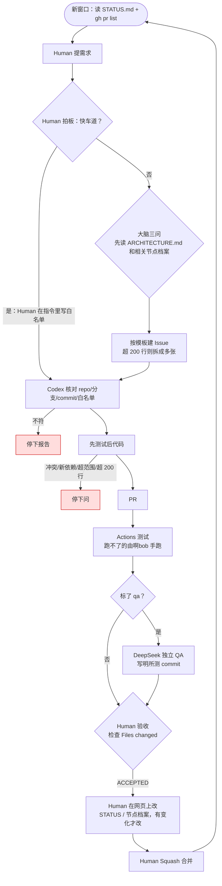

# 工作流 v2.4（最终版，冻结）

> 底子：v2.3.5 红线 + HAC 骨架（Issue/PR、停机条件、规则只减不加）。
> 本文给 AI 窗口读，称呼固定，不用"你/我"。
> **冻结**：只有试运行里的记录才能触发修改。

## 0. 角色

| 角色 | 是什么 | 做什么 | 不做什么 |
|---|---|---|---|
| Human | 项目负责人（本人） | 提需求、拍板快车道、验收、合并前在网页上改 STATUS 和节点档案、合并、授权 | — |
| 大脑 | ChatGPT 窗口 | 三问、拆卡、按模板建 Issue | 不写代码、不跑测试、不合并 |
| Codex | 本地 Codex | 按 Issue 写测试和代码、提 PR | 不合并，不改白名单外的文件 |
| GitHub Actions | CI | 每个 commit 自动跑测试 | — |
| 啊bob | 另一个 AI agent（Grok Bot） | 配置 Actions；跑 Actions 跑不了的测试 | 不写卡、不改业务代码、不合并、不签 QA PASS |
| DeepSeek | 独立 QA | 只对标了 `qa` 的 PR 做 QA | 不写仓库 |

## 1. 风险判定（快车道和 `qa` 标签共用）

碰到以下任一项即为**高风险**：
- 写入、删除或改格式的持久化数据
- 鉴权、支付、迁移、依赖变更、不可逆操作

**拿不准按高风险。** 高风险必须标 `qa`，不得走快车道。AI 只按清单提醒，快车道由 Human 拍板。

## 2. 行数口径

- 一个 PR 的行数 = 业务代码 + 测试的新增与删除之和。不算锁文件、自动生成的文件、STATUS 和 docs。
- 上限 200 行。估算超过就拆卡；实际 diff 超过就按"超范围"走 X2 停下。
- 快车道上限 20 行。
- 这个数靠试运行校准：多数卡都顶到上限、被拆碎了就调高；从来碰不到就不动。

## 3. 流程图（只画主线和停机点）



**回路（不画线，按文字执行）**
- 测试失败 / QA FAIL 代码错 / REJECTED 代码问题 → 回 Codex 修。**第 3 次回修之前停下，回大脑三问。**
- QA FAIL 规则或需求错 / REJECTED 需求理解错 → 回大脑三问。
- BLOCKED 第 1 次 → 补条件重测；第 2 次 → Human 决定修环境还是跳过，跳过要在 PR 里写明风险。
- 拆卡不回到 Human 提需求，直接建多张 Issue。
- 每次停机（X1/X2）、回修、BLOCKED，都在 Issue 或 PR 评论里留一行。没留痕的，就算没触发过。

## 4. 三问（每问一句话，答不出就回 Human）

先读 ARCHITECTURE.md 和相关节点档案，再答：
1. 真实目标是什么
2. 哪些可以砍
3. 最可能在哪出错（写进 Issue 的"验收点"）

## 5. 状态放在哪（每样只放一处）

| 内容 | 放哪 |
|---|---|
| 卡、白名单、行数、要不要 QA | Issue |
| 在途的卡 | `gh pr list` / 开着的 Issue |
| 测试结果 | Actions run（手跑的贴在 PR 评论） |
| QA 结论、停机和回修记录 | PR / Issue 评论 |
| 已合并的内容 | git log |
| 阶段、下一步、已知风险和跳过项 | `STATUS.md` |
| 踩过的坑和做过的决定 | `docs/nodes/<节点>.md`，有才追加，三问前要读 |

**永远不在 Codex 白名单里**：`.github/workflows/`、`STATUS.md`、`docs/nodes/`。

## 6. 规则

1. **快车道**：由 Human 拍板，只限低风险且 ≤20 行。省掉三问和 Issue，但仍要走 G 和停机条件，白名单由 Human 在指令里写明。PR 第一行写"快车道：<一句说明>"。
2. **WIP 上限**：同时最多 2 个没合并的 PR，快车道的 PR 也算。
3. **测试证据**：
   - 默认证据是 Actions run：命令在 workflow 里，退出码看检查状态，日志看 run 页面，commit 看 run 的 SHA。
   - Actions 跑不了的测试（硬件、本地数据、桌面端 E2E）由啊bob 手跑，并贴出命令、退出码、Human 能打开的原始日志和所测的 commit。
   - 手跑的证据和 QA 结论都要写明所测 commit。和 PR 最新 commit 不一致就作废，重新跑。
   - 唯一豁免：在 QA 之后，如果新 commit 只改了 `STATUS.md` 和 `docs/nodes/`，DeepSeek QA 不用重做。Human 合并前在 Files changed 里确认确实只改了这两处。
4. **回修上限**：第 3 次回修之前停下，回大脑三问。
5. **部分完成**：ACCEPTED 但有没做完的部分，直接新开 Issue，不留口头的"有条件验收"。
6. **QA 评估**：单独计数。跑满 5 张标了 `qa` 的卡就评估一次，如果独有发现为 0，就砍掉 DeepSeek 这一步。
7. **红线不变**：没有 Human 授权，不合并、不部署、不做不可逆操作；不覆盖未知改动、日志和测试证据。
8. **规则只减不加**：同一个问题漏过两次才加规则。每 10 张卡，按停机、回修、BLOCKED、部分完成的记录，删掉从没触发过的**事件类规则**（回修上限、BLOCKED、部分完成、快车道）。**防护类规则**（红线、WIP 上限、commit 绑定、永久禁区、风险判定）不按触发次数删。

## 7. Issue 模板

```markdown
目标（一句话）：
三问改了什么：无 / ...        （和 Human 原始需求比）
验收点 / 先写的测试：          （第三问"最可能出错"写在这里）
白名单文件：
预估行数：                     （业务+测试，超过 200 就拆）
标签：qa / 无
```

## 8. PR 模板

```markdown
关联：closes #N（快车道写：快车道：<一句说明>）
改动文件：
测试命令：
未验证项：
```
- 测试结果看 Actions，手跑的由啊bob 贴在评论里。
- Human 验收时在评论里填一行 `QA 独有发现：无 / ...`。判断方法：问自己"没有这条发现，我会不会放行？"会放行，就算独有发现。

## 9. STATUS.md 模板

```markdown
# STATUS
阶段：
下一步：
## 已知风险 / 跳过项
- 
```

## 10. 节点档案模板（有坑才追加）

```markdown
# <节点名>
## 踩过的坑和决定
- YYYY-MM-DD  PR #N：<问题> → <怎么处理/决定>
```

## 11. 开跑前的一次性准备（不走流程）

1. 啊bob 配好 Actions（Windows runner），先只挂核心测试。私有仓库的 Windows 分钟数按倍率计费，具体倍率以 GitHub 当前的计费页为准。
2. 如果账号方案支持，给 main 开分支保护：只能通过 PR 合并，检查必须通过。
3. 在仓库里建好 `STATUS.md`、`docs/nodes/`、Issue 模板和 PR 模板。

## 12. 试运行

- 范围：M0 收尾之后的卡。M0 收完之前不改流程。
- 普通卡跑满 10 张，按规则 8 清理一次；`qa` 卡按规则 6 单独计数；行数上限按第 2 节校准。
