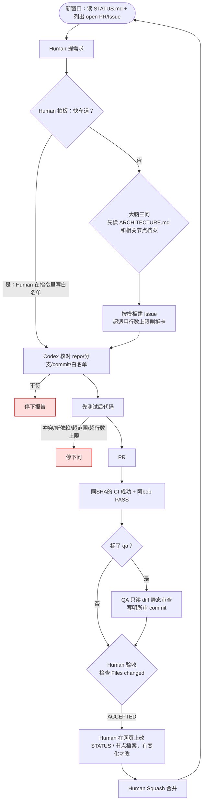

# 工作流 v2.4（最终版，冻结）

> 底子：v2.3.5 红线 + HAC 骨架（Issue/PR、停机条件、规则只减不加）。
> 本文给 AI 窗口读，称呼固定，不用"你/我"。
> **冻结**：只有试运行里的记录才能触发修改。

## 0. 角色

| 角色 | 是什么 | 做什么 | 不做什么 |
|---|---|---|---|
| Human | 项目负责人（本人） | 提需求、拍板快车道、验收、合并前在网页上改 STATUS 和节点档案、合并、授权 | — |
| 大脑 | ChatGPT 窗口 | 三问、拆卡、按模板建 Issue | 不写代码、不跑测试、不合并 |
| Codex | 本地 Codex | 按 Issue 写测试和代码、提 PR | 不合并，不改白名单外的文件 |
| GitHub Actions | CI | 每个 commit 自动跑测试 | — |
| 啊bob | 独立运行验收角色 | 每卡验收；补CI未覆盖的运行验证，承接卡内负例需求 | 不写卡、不改业务代码、不合并、不代签 QA PASS |
| QA | 静态审查角色；当前配置 gpt-6.1-sol | 仅对 `qa` 标签 PR 读 diff；判断独立，不宣称模型异源 | 不跑测试、不写或运行独立用例、不改仓库 |

## 1. 风险判定（快车道和 `qa` 标签共用）

碰到以下任一项即为**高风险**：
- 写入、删除或改格式的持久化数据
- 鉴权、支付、迁移、依赖变更、不可逆操作

**拿不准按高风险。** 高风险必须标 `qa`，不得走快车道。AI 只按清单提醒，快车道由 Human 拍板。

QA条件触发试验期内，持久化、鉴权、分页卡继续打 `qa`；原支付、迁移、依赖及不可逆操作等高风险边界不变。非 `qa` 卡默认门禁为同SHA的 CI 成功 + 阿bob PASS；仅 `qa` 标签卡另要求 QA 对同SHA的 diff 静态审查 PASS，不把未调用QA写成QA通过。需要补负例时由大脑写进实现或阿bob的卡，由该责任人补测；QA只指出疑点位置与契约依据。

## 2. 行数口径

- 一个 PR 的行数 = 业务代码 + 测试的新增与删除之和。不算锁文件、自动生成的文件、STATUS 和 docs。
- 普通卡上限 200 行。估算超过就拆卡；实际 diff 超过就按"超范围"走 X2 停下。下述专项仅覆盖其明确范围。
- 快车道上限 20 行。
- 这个数靠试运行校准：多数卡都顶到上限、被拆碎了就调高；从来碰不到就不动。

### 已有代码迁移专项试运行：HoSaiLei UI V2

- 仅适用本批已实现 UI V2 的迁入：来源 `codex/hsl-uiv2-04-i02`、首提交 `479a40a0d62a58b94874f82a7aaa7e6f60538a62` 至末提交 `c4508fc4192cbff70bb0f3dc94e787f9f63d6345`；派卡前须能读取完整来源并固定来源/目标 SHA，不能凭“成熟代码”声明免验。
- 每 PR 业务代码增删 ≤500 行，测试增删另计 ≤500 行，合计 ≤1000 行；Issue/PR 分列两项，任一超限仍 X2 拆卡。样式、i18n 和进入产品构建的辅助代码均计业务，不因文件名或“搬运”而豁免。
- 只迁移来源已有功能及其测试；必要适配计入业务并逐项说明。新增需求、依赖、数据格式迁移或鉴权/权限语义变化另走普通 ≤200 行卡，不夹带扩展。
- 每卡标 `qa`，不是快车道；QA 核对“来源基线→来源终点”和“当前 main→Candidate”两份差异，区分迁入/适配，检查来源断言未删弱及当前 main 的有效修改未被覆盖。
- 复用现有 CI 和独立 QA，不新增脚本或审批关卡；补迁移相关运行验证：看板列宽/列操作及旧设置兼容、任务卡操作/进度、审核证据与候选/状态映射。旧截图、旧 QA 和旧测试不替代当前 Candidate 证据。
- 保留三个验收组，暂按四张可运行的迁移卡组织；不得为凑卡数提交不可编译的组件/半个测试。最多两个未合并 PR，共享组件/样式/i18n 的依赖卡串行。
- 触发记录（2026-11-03）：Human 提供 13 文件 +1679/-287，其中测试 913 行、业务 1053 行；全含测试 ≤200 行导致约 13 卡的拆分设计。该方案未执行，成本节约与“成熟度”均未实测，来源远程可读性尚待落实；本条是 Human 明确指定的专项试验，非普通卡试运行结论。
- 仅在本规则 PR 经 Human 验收合并后使用；完成本批后记录实际卡数/适配量/回修及 QA 发现，决定保留、调整或撤销，不自动推广到其他迁移。

## 3. 流程图（只画主线和停机点）

**回路（不画线，按文字执行）**
- 测试失败 / QA FAIL 代码错 / REJECTED 代码问题 → 回 Codex 修。**第 3 次回修之前停下，回大脑三问。**
- QA FAIL 规则或需求错 / REJECTED 需求理解错 → 回大脑三问。
- NOT_TESTED（整份 QA 无法进行）按 BLOCKED 处理。
- BLOCKED 第 1 次 → 补条件重测；第 2 次 → Human 决定修环境还是跳过，跳过要在 PR 里写明风险。
- 辅助脚本类 BLOCKED 按下述“验收减负”专项：同一 PR 同类最多两轮，不进入第三轮；不涉及产品代码与断言的仓外纠正只留一行，不逐次发裁定。其他 BLOCKED 保持原规则。
- 拆卡不回到 Human 提需求，直接建多张 Issue。
- 每次停机（X1/X2）、回修、BLOCKED，都在 Issue 或 PR 评论里留一行。没留痕的，就算没触发过。
- X1/X2 的具体触发条件以 Codex 指令为准。

## 4. 三问（每问一句话，答不出就回 Human）

先读 ARCHITECTURE.md 和相关节点档案，再答：
1. 真实目标是什么
2. 哪些可以砍
3. 最可能在哪出错（写进 Issue 的"验收点"）

## 5. 状态放在哪（每样只放一处）

| 内容 | 放哪 |
|---|---|
| 卡、白名单、行数、要不要 QA | Issue |
| 在途的卡 | GitHub 上开着的 PR / Issue |
| 测试结果 | Actions run（手跑的贴在 PR 评论） |
| QA 结论、停机和回修记录 | PR / Issue 评论 |
| 已合并的内容 | git log |
| 阶段、下一步、已知风险和跳过项 | `STATUS.md` |
| 踩过的坑和做过的决定 | `docs/nodes/<节点>.md`，有才追加，三问前要读 |

**永远不在 Codex 白名单里**：`.github/workflows/`、`STATUS.md`、`docs/nodes/`。

## 6. 规则

1. **快车道**：由 Human 拍板，只限低风险且 ≤20 行。省掉三问和 Issue，但仍要走 G 和停机条件，白名单由 Human 在指令里写明。PR 第一行写"快车道：<一句说明>"。
2. **WIP 上限**：同时最多 2 个没合并的 PR，快车道的 PR 也算。
3. **测试证据**：
   - 默认证据是 Actions run：命令在 workflow 里，退出码看检查状态，日志看 run 页面，commit 看 run 的 SHA。
   - Actions 跑不了的测试（硬件、本地数据、桌面端 E2E）由啊bob 手跑，并贴出命令、退出码、Human 能打开的原始日志和所测的 commit。
   - 手跑证据写所测 commit，QA结论写所审 commit；与 PR 最新 commit 不一致则作废，运行验收重新核验，QA重新读diff静态审查，不要求QA跑测试。
   - 唯一豁免：在 QA 之后，如果新 commit 只改了 `STATUS.md` 和 `docs/nodes/`，QA 不用重做。Human 合并前在 Files changed 里确认确实只改了这两处。
4. **回修上限**：第 3 次回修之前停下，回大脑三问。
5. **部分完成**：ACCEPTED 但有没做完的部分，直接新开 Issue，不留口头的"有条件验收"。
6. **QA 评估（条件触发试验）**：先在[验收说明](docs/acceptance-automation.md)补齐历史5项“无QA时拦在哪层/会漏”；本修订由Human手合后，从下一张新进入验收的 `qa` 卡起算5张，按唯一卡去重，历史卡和同卡回修/复验不重计。独有发现必须是真缺陷，且同一缺陷候选已有CI绿、阿bob PASS，若无QA该缺陷仍会放行；事后按QA提示补出的负例不算另一层事前已发现。阿卡沿既有PR评论记录卡号、SHA、三方证据及独有发现，由阿Pi沿现有账本汇总，不新增检查环节。证据不足标UNKNOWN，不当作零；第5张结束时结算，若核实独有发现为0则按本规则取消QA步骤，非零则保留，UNKNOWN未解决则报Human裁定。未满窗口不得宣称已取消QA；取消QA步骤不撤销高风险标签、CI、阿bob或其他红线。
7. **红线不变**：没有 Human 授权，不合并、不部署、不做不可逆操作；不覆盖未知改动、日志和测试证据。
8. **规则只减不加**：同一个问题漏过两次才加规则。每 10 张卡，按停机、回修、BLOCKED、部分完成的记录，删掉从没触发过的**事件类规则**（回修上限、BLOCKED、部分完成、快车道）。**防护类规则**（红线、WIP 上限、commit 绑定、永久禁区、风险判定）不按触发次数删。
9. **报告上墙**：每张卡做完，结论必须进 PR 评论，摘要在上、原文用 `
` 折叠在下。
   - Codex：交付时自己把执行报告贴到 PR 评论（含所测 commit）。
   - QA：完成后自己用 `gh pr comment` 把结论贴到 PR 评论（含所测 commit），评论第一行固定写 `QA：`（它用 Human 账号发评论，靠这行区分）。历史旧前缀不改写。贴不上时 Human 把原文转给啊bob，由啊bob 原样贴上，不改结论。
   - 大脑出的回修/补证据卡里写明这一条，缺报告评论的 PR 不进验收。

## 7. 模板（只放一处，以文件为准）

### 验收减负（2026-11-05 Human 指定，PR20 已合并；本节为后续修订）

- 固定仓外脚本保持“候选”。阿bob从下一张真实验收起试用，前两张真实卡均完成锁定 SHA、安装、定向/全量/文档检查、保全、脱敏打包发布回读且没有脚本自身阻塞，记录两张卡的PR/SHA/原始证据后才可转正；当前0/2。首次使用即联调，不单开联调卡。任何一张被脚本自身卡住立即回退手动，不为修脚本阻塞产品验收。每卡只写独立用例，详见[候选入口与回退](docs/acceptance-automation.md)。
- 同一 PR 同类辅助错误最多两轮；第二轮仍未解除时，按已有证据出有明确覆盖边界的结论，证据不足报 Human，不继续第三轮。不碰产品代码、断言、预期与权限的仓外辅助修正只在 PR 留一行，不逐次申请裁定。两条规则不依赖脚本是否采用、转正或回退，回退手动不清零计数；权限、安全、白名单及产品回修边界不变。
- 平台暂不支持唤醒前过滤，撤出该接入方案，改为降低定时频率：阿Pi巡检15→60分钟，整点汇总→每日10/14/18点，五项指标仍每日17:55；阿卡兜底核对40→120分钟，执行者实际执行满40分钟主动汇报的要求保留。均为北京时间，完整安排及代价见上述文档；不声称已节省完整回合。
- QA按第1节条件触发，只读diff；固定脚本与独立运行用例属于阿bob验收，不交给QA。历史五项说明与实际模型证据见上述文档，精确运行型号缺失写 UNKNOWN，不用当前配置反推历史。
- 本次试验以条件QA替代每卡双PASS要求；CI、阿bob、WIP、SHA绑定、安全边界和Human合并权限不变。当前 QA 配置为 gpt-6.1-sol，角色已改名 QA；与实现者可能同源，审查仍独立，当前配置不反推历史运行身份。

- Issue 模板：[`templates/.github/ISSUE_TEMPLATE/task.md`](templates/.github/ISSUE_TEMPLATE/task.md)
- PR 模板：[`templates/.github/pull_request_template.md`](templates/.github/pull_request_template.md)
- STATUS 模板：[`project-skeleton/STATUS.md`](project-skeleton/STATUS.md)
- 节点档案模板（有坑才追加）：[`project-skeleton/docs/nodes/_TEMPLATE.md`](project-skeleton/docs/nodes/_TEMPLATE.md)
- 测试结果看 Actions，手跑的由啊bob 贴在评论里。
- Human 验收时核对评论中的 `QA 独有发现：无 / 缺陷及证据 / UNKNOWN`；判据按规则6，即CI绿且阿bob已PASS仍会放行的真缺陷。历史5项不计入新窗口。

## 8. 开跑前的一次性准备（不走流程）

1. 啊bob 配好 Actions（Windows runner），先只挂核心测试。私有仓库的 Windows 分钟数按倍率计费，具体倍率以 GitHub 当前的计费页为准。
2. 如果账号方案支持，给 main 开分支保护：只能通过 PR 合并，检查必须通过，勾上"包含管理员"。不支持时，由 Human 合并前确认 CI 为绿。
3. 在仓库里建好 `STATUS.md`、`docs/nodes/`、Issue 模板和 PR 模板。
4. 给啊bob 的凭据用 fine-grained token 或独立 bot 账号，只授权所需仓库，不用 Human 本人账号登录。

## 9. 试运行

- 普通试运行范围：M0 收尾之后的卡，M0 收完之前不改其他流程；本次 Human 指定的 UI V2 迁移专项是唯一例外，按第 2 节执行。
- 普通卡跑满 10 张，按规则 8 清理一次；`qa` 卡按规则 6 单独计数；行数上限按第 2 节校准。
